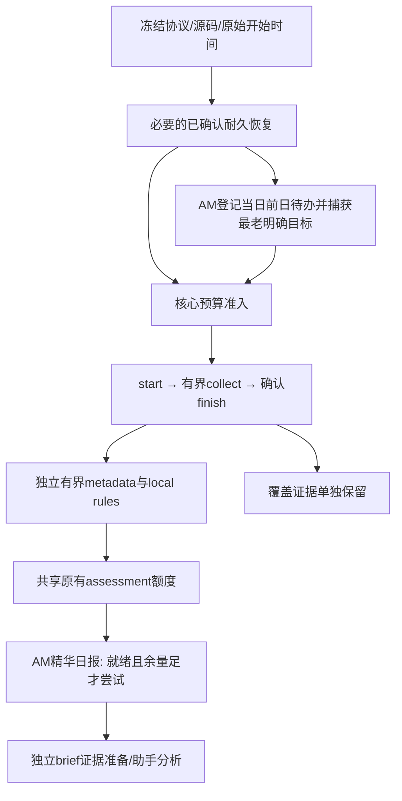

# 核心采集目标与独立产物

维护记录：2026-10-25T08:01:43Z（UTC+08 16:01:43）。仓库基线dbfc1087e5775b91dbf30125bde1753534c534d0；父端报告生产v104/source34eeaead9486b4b112000f1521bc0f1f90cb1ead，固定bootstrap2d2d07f。本任务仅仓库实现和隔离验证，不访问生产、不补跑失败批、不改任务/pin，不调用真实供应商或付费模型。

## 已证实的故障链

父端官方Worker日志确认：25日08时的recover和previous_day metadata已返回ok，scoring返回ok/work_pending；daily随后HTTP200、known=1、deferred/pending_scoring。这是实际未完成评分的业务门控，不是本轮猜测的预算或provider故障。旧固定bootstrap将该安全暂缓当成全任务阻断，在start之前退出；其诊断白名单又把pending_scoring映射成other。

问题在目标编排，而不只是一个if：原AM最多两片metadata、120秒评分及190秒日报都在采集之前，加上预留110秒维护时间，会让核心采集预算饥饿。旧实现只余20秒也可能POST start并算出0采集预算；daily partial可能包含unknown receipt，不能反过来将所有deferred/partial统一放行。

真实旧2d2 checkout子进程已原样复现该链；原测试仅PM且start直接finished，不能证明AM真正collect成功。

## 目标级状态机

PM不登记/生成日报，处理current；AM优先维护捕获的previous目标，唯一付费assessment额度给该目标，current只做剩余时间内metadata/local rules。每目标分别记录status、固定reason、sourceDay/reportDate和nextAction；部分产物未完成不抹去已确认采集事实。

| 边界 | 执行与事实 |
| --- | --- |
| 总预算 | D=min(真实automationStartedAt+538秒,SG09/21结束点)，保留原540秒总限及2秒响应余量。提前get_site/下载/stdin/等待均已经耗时，开始时点不重置 |
| 必要恢复 | 最多原有4片；只有known/confirmed且实际提交进展才续片；pending、取消或未知不能伪称清空 |
| 开批 | 至少105秒有效余量：start15+一个settled slice30+最多四片finish60。不足可登记AM待办，但不start/collect |
| 采集 | 原AM260/PM330秒上限、每slice≤75秒、并发≤3、客户端35次来源调用、服务端原子35分页限额全部保留；预留60秒收尾，覆盖不保证32源完整 |
| metadata/rules | 仅当前日或捕获的已登记前日目标；partial有独立ready证据可做local rules，但scopePending/remainingMetadata不得当成整份日报已就绪 |
| assessment | AM整轮最多原1篇、PM原2篇，只在一个付费目标派发；local maxPapers=0不消耗付费额度；remainingQueued正数仍是债务 |
| daily | AM原≤2 calls，仍需≥190秒；pending_metadata/scoring只延期该目标；先检查unknown queue/receipt、lease、fence和版本证据，不能仅看HTTP200 |
| brief | 新runtime finish内部deferBrief，不等待简报写入；核心终态与coverage先返回。随后固定brief/prepare独立请求；未知不重放，助手生成和publish仍是原独立授权流程 |

任何POST未知、错误身份/Origin/marker、冻结源码/hash/能力变化、lease/CAS失效、取消、未确认finish，都停止后续写入。模型回执unknown/pending通过unknownAttempts/queue显式传递，不能因partial或blocked被清空而继续。已完成的collection目标仍保留，不把可选产物故障写成“未采集”。

## 持久待办与日期归属

新增固定plan操作只复用research_daily_work：AM仅INSERT OR IGNORE本执行日reportDate/昨日sourceDay。重复计划不改已有记录；不扫历史论文推断待办、不注册失败批次、不创建后台任务或新表。

目标选择复用最老显式未冻结工作，另承认已冻结daily中仍queued/running的输入本身就是持久任务；不为缺旧work行造历史账。failed/unknown组不自动重放。capture的sourceDay/reportDate贯穿metadata、scoring、daily，服务端在日志/init/reconcile前只读核对；若并发已推进目标则runtime_goal_changed，而非静默处理下一日。已完成/empty且无queued/running时可作为完成事实复用。

同一次日报恢复、领取、回写、计数都仅一个捕获date，不能把旧backlog、昨日与今日混成一次产物。后续原计划窗口可继续既有明确欠账，仍受原时间/调用/模型预算；不能据此扫描未登记历史或批量付费补账。所有维护跳过时，当日work仍持久，不因次日日期前移遗失。

新增持久行为仅为当前执行日登记一条既有work记录及原有目标状态更新，属于本轮修复；新表、扫描过去缺失日期、后台常驻、重放unknown、扩大费用或历史批次补跑均未实现，仍需另行明确授权与审查。

## 协议、bootstrap与部署兼容

模板为scheduled-am-v2/scheduled-pm-v2，必需能力增加collection-first-v1；协议主版本与固定namespace仍为hkis-runtime-v1。新增固定plan/brief路径，无任意URL/代码/方法/重排。previous_day/daily只能带捕获sourceDay，经服务端验证后剥离HTTP字段并以可信内部预算上下文传递；旧业务API不能指定任意日期。

旧2d2无法通过发布站点改变自身执行顺序，它会拒绝新能力并在POST前停止。新bootstrap也拒绝旧v1模板，不降级。需父端审查一次新bootstrap完整SHA与站点新模板成对切换；本任务不更新真实pin或发布。之后支持的同模板/能力兼容Site更新仍无需逐版手填Site SHA。无manifest的旧CLI/直接调用保留历史profile兼容，已不属于新正式任务，不应拿它验收新能力。

精确v104移植：research-runtime-contract、runtime-budget、runtime、research-run-plan、research-cohorts、research-diagnostics；research.ts仅process trusted budget与finish deferBrief两窄行；research-batches仅finish显式defer分支；enrichment/process/daily沿固定目标及unknownAttempts。bootstrap固定checkout所需五文件run-stable-research-slot.mjs、run-research-slot.mjs、research-slot.ts、research-diagnostics.ts、research-runtime-contract.ts须同一提交。新brief操作复用既有briefApi，不移植manual或依赖升级，不更改reader/first_seen/评分历史/已published输入。

## 故障注入矩阵与验收

| 场景 | 必须观察的结果 | 验证层 |
| --- | --- | --- |
| 旧AM真实daily pending_scoring | 原样复现start/collect=0，reason旧other；新模板core先确认且daily独立延期 | 真实clean bootstrap子进程+loopback |
| 每个实际POST未知/503/坏JSON/错回显 | 最后一次请求后停止，不重放、不重新GET、不强制finish | AM/PM实际子进程全部写入位置注入 |
| 日报无就绪/未评分/lease/配置不可用/已完成 | 与未知分别分类，核心完成事实不丢失，不多派发paid | 子进程+真实领域服务隔离数据 |
| metadata部分完成、剩余评分队列 | 仅独立ready继续local；pending计数保留、日报不能误认为准备完成 | bootstrap+SQLite真实migrations |
| 旧backlog/昨日/今日共存、目标并发变化 | 固定同一日期；新阶段写前拒绝漂移；不修改其他冻结输入 | runtime+private dispatch+SQLite |
| 提前准备、慢DB、GET消耗总预算、低于105秒 | 保留原开始；余量不足不start/不新派发；work登记可留存 | 可控双端时钟+runtime/D1 |
| 终态CAS成功后brief失败/未知 | 新模板finish不触brief；旧未知保留；独立brief未知不否认已确认core | SQLite注入+native Worker |
| 取消、并发、partial来源覆盖 | 原租约/预算门控不放松，部分覆盖不冒充完整 | 既有域测试+新bootstrap/Worker |
| 原论文、reader、冻结简报/日报 | 逐对象保护快照不变；允许新当前批次/待办/来源证据正常新增 | 隔离SQLite/真实D1 |

具体完成数及任何失败重验由最终交付列明；不以表中“验证层”当作未执行的通过声明。旧Node/PG新闻引擎未改，前轮156/183、27个关模型阀基线失败继续保留，不为旧引擎打开模型阀。
